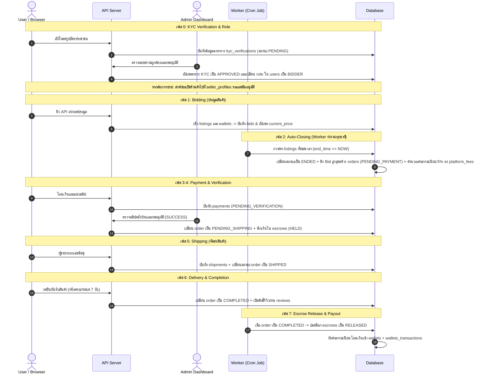

# Rakadee — เว็บประมูลสินค้าออนไลน์

งานรายวิชา CSI204 ระบบประมูลสินค้าออนไลน์แบบ real-time พร้อม Mock Wallet, Escrow และระบบจัดการข้อพิพาท

## ติดตั้งและรัน

ต้องมี [Node.js](https://nodejs.org) 20 ขึ้นไป และ MySQL 8

```bash
cd backend
npm install
cp .env.example .env      # Windows: copy .env.example .env
# แก้ค่า DB_* ใน .env ให้ตรงกับ MySQL ในเครื่อง
npm run dev
```

เปิด http://localhost:3000 หน้าแรกจะแสดงสถานะ API และ Database

- `npm run dev` รีสตาร์ตเองเมื่อแก้ไฟล์ (ใช้ตอนพัฒนา)
- `npm start` รันปกติ

> ตอนนี้ยังไม่มีตาราง ถ้า Database ขึ้นว่า unavailable ให้เช็กว่า MySQL เปิดอยู่และสร้าง database ชื่อ `rakadee` แล้ว (`CREATE DATABASE rakadee;`) ตารางจะมาพร้อม ERD ของ SA

## ใช้ AI เขียนโค้ด

ทุกคนในทีมใช้ AI ช่วยเขียนโค้ด กติกาทั้งหมดอยู่ใน [`AGENTS.md`](AGENTS.md) (Claude Code อ่านผ่าน `CLAUDE.md` ส่วน Cursor/Copilot/Codex อ่าน `AGENTS.md` เอง)

ทุกครั้งที่สั่งงาน AI ให้แนบหรือชี้ไปที่:

1. `AGENTS.md`
2. `docs/decision-log.md`
3. `docs/erd/schema.sql` และ `docs/api-spec/openapi.yaml`
4. ข้อในเอกสาร requirement ที่เกี่ยวกับงานนั้น

ตัวอย่างคำสั่ง:

> อ่าน AGENTS.md, docs/decision-log.md, docs/erd/schema.sql และ docs/api-spec/openapi.yaml ก่อน แล้วทำ API ลงสินค้า (POST /api/listings) ตาม requirement ข้อ 3.1–3.3 ที่แนบมา ทำเฉพาะโมดูลลงสินค้า ห้ามแก้ไฟล์โมดูลอื่น เสร็จแล้วบอกวิธีทดสอบทีละขั้น

## โครงสร้าง

```
backend/    Express API, Socket.IO, Scheduler (node-cron)
frontend/   HTML / CSS / JS (เสิร์ฟจาก backend ที่ port เดียวกัน)
docs/       Decision Log, ERD, API Spec
```

รายละเอียดโฟลเดอร์และกติกาการเขียนโค้ดอยู่ใน `AGENTS.md`

## การทำงานร่วมกัน

- `main` = เวอร์ชันพร้อมเดโม, `dev` = รวมงานระหว่างพัฒนา
- แตก branch จาก `dev` ชื่อ `feature/<module>-<งาน>` แล้วเปิด Pull Request เข้า `dev` ให้ PM review
- ห้าม push ตรงเข้า `main` หรือ `dev`

## ทีม

| ตำแหน่ง | โมดูล |
| --- | --- |
| PM | Foundation, Notification, Settings, Shipping, Admin Dashboard, Audit Log |
| SA | Auth, Wallet, Payment, Escrow, ERD, API Spec |
| QA | ลงสินค้า, อนุมัติสินค้า, Dispute, บทลงโทษ, จัดการผู้ใช้, Test Plan |
| Programmer | Auction Engine, หน้าแรก, ค้นหา, รายละเอียดสินค้า, Watchlist |


## System Architecture & Sequence Diagram

### 1. โครงสร้างระบบ (Actors & Components)
1. **`User / Browser`** (ฝั่งผู้ใช้: ผู้ซื้อ/ผู้ขาย)
2. **`Admin Dashboard`** (ฝั่งแอดมิน)
3. **`API Server`** (หลังบ้าน / Backend Controller)
4. **`Worker`** (ระบบรันอัตโนมัติเบื้องหลัง เช่น เช็คเวลาหมดประมูล)
5. **`Database`** (ฐานข้อมูลหลักของระบบ)

### 2. ลำดับขั้นตอนการทำงานของระบบ (Sequence Flow)

